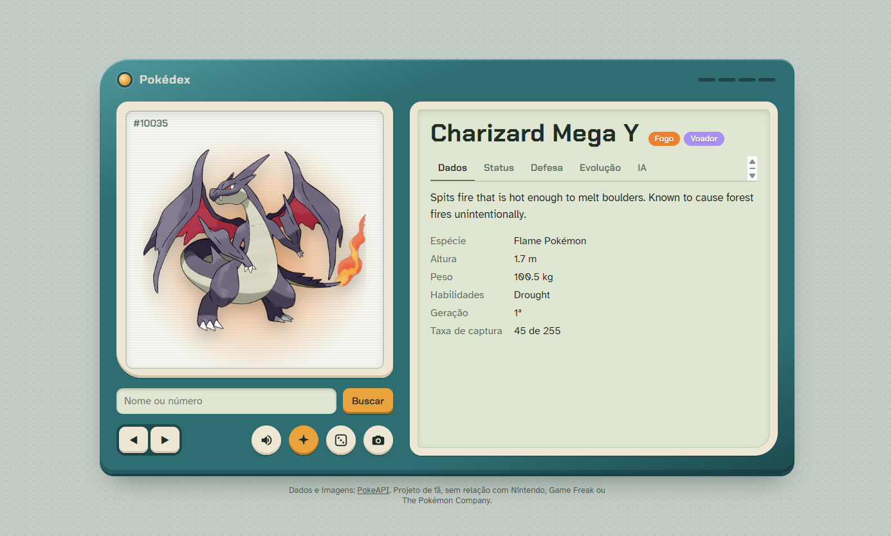

# Pokédex

Comecei isso querendo uma Pokédex que rodasse no terminal e acabou virando duas: uma de terminal,
com os sprites desenhados em caracteres coloridos, e outra no navegador, com a arte oficial em alta
resolução e uma IA que conversa sobre o Pokémon na tela.

Os dados vêm da [PokeAPI](https://pokeapi.co). Tudo que é consultado fica salvo em cache, então a
segunda busca é instantânea e dá pra usar sem internet depois.

<!-- print da versão web:  -->

## Rodando

Precisa de Python 3.10 ou mais novo.

```bash
git clone https://github.com/guipmartins/pokedex-cli.git
cd pokedex-cli
python -m venv .venv
.venv\Scripts\activate        # no Linux/macOS: source .venv/bin/activate
pip install -e .
pokedex web
```

O navegador abre sozinho em `http://localhost:8000`.

### A parte da IA

É opcional. Sem chave tudo funciona, só some a aba de IA e a identificação por foto. Pra ligar,
copie o `.env.example` para `.env` e coloque a chave da Anthropic ou da OpenAI:

```env
ANTHROPIC_API_KEY=sk-ant-...
```

ou `OPENAI_API_KEY=...`. O modelo pode ser trocado com `AI_MODEL`.

Com ela ligada dá pra:

- pedir pra Pokédex narrar a entrada do Pokémon em português (e ouvir em voz alta);
- perguntar coisas tipo "ele aguenta um Gyarados?" ou "qual natureza combina com ele?";
- mandar uma foto, print, desenho ou pelúcia e deixar ela descobrir qual Pokémon é.

## Versão web

Na tela da esquerda fica a arte oficial, com botão de shiny e o grito do Pokémon. Na da direita ficam
dados, status, fraquezas, a linha evolutiva (clicável) e a conversa com a IA. As setas do teclado
passam pro anterior e pro próximo, e cada Pokémon tem seu próprio link, tipo `localhost:8000/#gengar`.

## Versão de terminal

```bash
pokedex show pikachu              # cartão completo com sprite
pokedex show charizard --shiny
pokedex random --gen 3
pokedex compare charizard blastoise
pokedex team garchomp gengar pikachu
pokedex types fogo voador
pokedex quiz                      # "Quem é esse Pokémon?"
```

O `team` foi o que eu mais curti fazer: ele monta a tabela de fraquezas do time inteiro, avisa
quando tem um tipo que derruba metade da equipe sem ninguém pra segurar, e mostra contra quais tipos
o time não tem golpe super efetivo.

Se errar o nome, ele sugere o certo. `Mr. Mime`, `mr mime`, `122` e `#122` dão no mesmo.

## Algumas decisões

**A IA recebe os dados prontos.** Em vez de deixar o modelo lembrar stats e fraquezas de cabeça (e
errar), o servidor manda junto os números da PokeAPI e as fraquezas já calculadas. A narração de
cada Pokémon fica em cache, então só paga uma vez.

**Sem SDK de IA.** As chamadas pra Anthropic e OpenAI são feitas direto com `httpx`. Fica menos
dependência e dá pra testar tudo trocando só o transporte HTTP.

**Imagem reduzida antes de mandar.** Foto de celular é grande. Antes de ir pro modelo de visão ela é
reduzida pra no máximo 1024 px e vira JPEG, o que deixa a chamada mais barata e mais rápida.

**Sprite no terminal com meio bloco.** Cada `▀` mostra dois pixels: a cor da letra pinta o de cima e
a cor de fundo pinta o de baixo. Um sprite de 96x96 cabe em umas 48 colunas.

**Tabela de tipos no código.** As 18x18 combinações estão em `type_chart.py`, então calcular 4× ou
¼× não depende de chamada nenhuma.

## Estrutura

```
src/pokedex/
  api.py          cliente da PokeAPI e sugestão de nomes
  cache.py        cache em disco
  models.py       dataclasses a partir do JSON da API
  type_chart.py   efetividade dos tipos
  ai.py           Claude / OpenAI: narração, perguntas e visão
  web/            servidor FastAPI e a página (HTML, CSS e JS puros)
  cli.py          comandos de terminal
  sprite.py       PNG para texto colorido
  render.py       cartões e tabelas do terminal
```

## Testes

```bash
pip install -e ".[dev]"
pytest
```

Os testes não acessam a internet nem gastam crédito de IA. As respostas da PokeAPI, da Anthropic e da
OpenAI são simuladas com `httpx.MockTransport`, mas o resto do código roda de verdade. O GitHub
Actions roda tudo em Windows e Linux, do Python 3.10 ao 3.13.

## Créditos

Dados e imagens da [PokeAPI](https://pokeapi.co). Pokémon é marca da Nintendo, Game Freak e The
Pokémon Company. Este é um projeto de fã, sem fins comerciais. O visual do aparelho foi feito do zero
pra este projeto.

Licença MIT.
